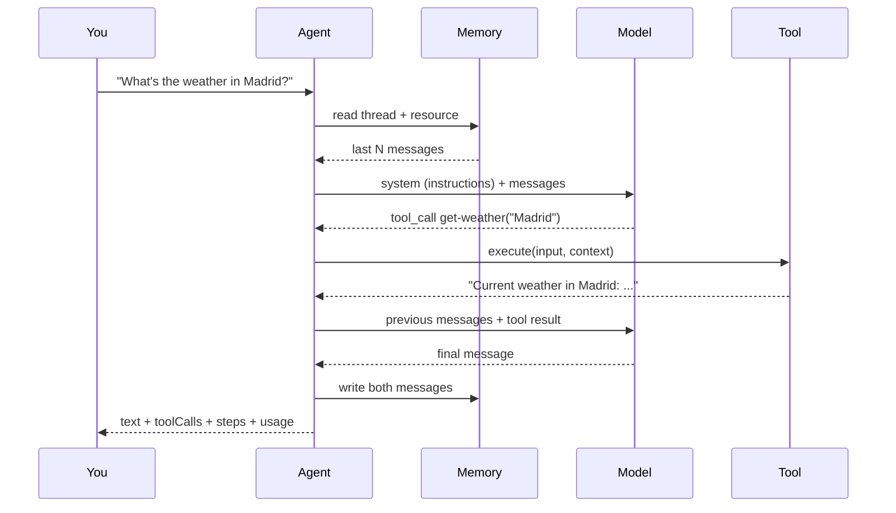

# 01 · The agent loop

**Subject:** what actually happens between your string and the answer, and how to see it.
**Time:** one sitting. No new primitives to learn — this lesson is about reading, not writing.

## Why this one first

Everything else in the path is an intervention at one specific point in a loop. Tools add a branch. Memory prepends context. Processors rewrite what goes in and comes out. Workflows decide who calls the agent and when. Scorers attach to the output. Subagents replace a tool call with another whole loop.

If you cannot see the loop, you cannot tell what any of those did. So lesson 01 is observation.

## What one `generate()` does



Three things worth noticing before you run anything:

1. **The model never calls the tool.** It emits a tool call; Mastra executes it and feeds the result back as a message. That is why a tool needs a schema — the schema is how the call is validated.
2. **The loop is a loop, not a chain.** The agent keeps cycling until the model stops asking for tools or a stop condition triggers. `maxSteps` exists because of this.
3. **Every box above becomes a span in the trace.** That is the whole lesson.

## The code

You are not modifying code in this lesson. Read these two files top to bottom:

- `../../src/mastra/lessons/01-agent-loop/weather-agent.ts` — `id`, `name`, `instructions`, `model`, `tools`, `memory`, and the commented `editor` options.
- `../../src/mastra/lessons/01-agent-loop/weather-tool.ts` — the tool the model can call: `id`, `description`, `inputSchema`, `outputSchema`, `execute`.

Then `../../src/mastra/index.ts` — it only merges lesson registries with shared storage and the editor. That is why the structure stays flat as the curriculum grows.

The model is `models.default` (`deepseek-v4-flash`) from `src/mastra/shared/models.ts`. That file builds an OpenAI-compatible provider against `OPENAI_BASE_URL` instead of using the router string `openai/deepseek-v4-flash`: the router uses OpenAI's Responses API, and the NaN gateway only speaks Chat Completions.

## Walkthrough A — headless

```bash
pnpm lesson 01
```

This mounts lesson 01 alone (`MASTRA_LESSONS=01-agent-loop`), asks the weather question, prints the answer plus token usage. Same loop, no UI. If it errors on the model call, fix the key in `.env` before continuing — nothing else in this lesson works without it.

The demo reuses the thread `l01-demo`, so run it twice and compare: the second answer knows about the first, and the first line of the trace is now history loaded from storage rather than an empty thread. That is `Memory` reading, before the model is called.

## Walkthrough B — the trace

```bash
pnpm dev
```

1. Open http://localhost:4111, go to **Agents**, select **L01 · Weather Agent**, and start a chat.
2. Ask: *What's the weather in Madrid?*
3. Open the **Observability** tab in the sidebar and open the trace for that run.

What you are looking for, in order:

- an agent/run span for the whole request
- one or more **LLM call** spans, each with the exact context that was sent
- a **tool call** span between them, with the validated input and the tool's return value
- memory reads/writes around the edges

Open the LLM call span and compare its system message with the `instructions` string in `weather-agent.ts`. Then look at the second LLM call: the tool result is in there as a message. That is the loop closing.

> The span names in your Studio version may differ slightly. Write down the names you actually see under **Notes** below — that vocabulary is what you will use to debug every later lesson.

## Walkthrough C — change behavior without touching code

The agent leaves `editor` unset, which is the most permissive setting: instructions and tool descriptions can be overridden, while `id`, `name`, and `model` always stay in code.

1. In the agent view, open **Editor**.
2. Change the instructions — for example, force a one-sentence answer.
3. Save as a draft, test it, then publish.
4. Re-run the same question and open the new trace. The system message changed; the code did not.

Then lock it down and watch the UI lose the ability:

```ts
// weather-agent.ts
editor: false,
```

Restart, revisit Editor, and confirm nothing is editable. While you are there, note the other form: `editor: { tools: { description: true } }` keeps instructions in code but still lets collaborators improve tool descriptions. `{ instructions: true }` is a *different* mode — it hands instructions entirely to Studio and forbids defining them in code.

Remember to revert to no `editor` key when you are done, or lesson 01 stops demonstrating the default.

## Walkthrough D — break it on purpose

Ask something the loop cannot resolve: *What is the weather on the moon?* Then *What is the weather in `{{`?*

Watch where it fails in the trace. A tool that throws and a tool that returns a failure string are different failure modes, and only one of them lets the model recover. That distinction is lesson 02's opening move.

## Checkpoint

Run these yourself; nobody can verify a trace for you.

- [ ] `pnpm lesson 01` prints an answer and a usage block.
- [ ] In Studio, you can point at the agent span, the LLM call spans, and the tool call span of one run.
- [ ] You can explain, from the trace alone, why the final answer says what it says.
- [ ] You changed the answer in Editor without editing code, and saw the new system message in a trace.
- [ ] You set `editor: false` and lost the ability to edit, then reverted it.
- [ ] You broke the tool once and know where that shows up.

## Notes

_Write what you learned here — three to five lines, in your own words, especially the real span names you saw._

- Span names I saw:
- The part of the loop that surprised me:
- Still unclear:

## Docs

- Agents overview — https://mastra.ai/docs/agents/overview
- Tracing — https://mastra.ai/docs/observability/tracing/overview
- Studio — https://mastra.ai/docs/studio/overview
- Studio Editor — https://mastra.ai/docs/studio/editor
- `Agent` reference — https://mastra.ai/reference/agents/agent
