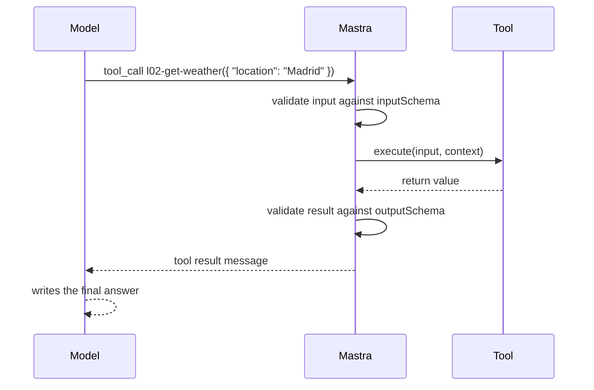

## Lab setup

**Objective:** Design tool contracts and understand failure recovery. **Time and cost:** 30–45 minutes; `WEATHER_MODE=fixture|timeout|malformed` changes weather only; agent generation still uses quota.

Start from this lesson's committed/reference baseline. Save a local copy before editing exercise variants; later lessons are isolated and do not inherit these edits. Stop Studio before `pnpm lesson 02` because both use the same writable DuckDB file, then restart it to inspect persisted traces. Use fictional data.


# 02 · Tools

**Subject:** giving the model actions, and getting the contract right so it calls them reliably.
**Prereqs:** 01 — you need to be able to read a tool-call span before debugging one.

## Why here

Lesson 01 showed the loop: the model never executes anything — it emits a tool call, and Mastra validates and runs it. This lesson is about the contract around that call. Everything later — retrieval (07), MCP (08), subagents (10) — is exposed to the model through tools, so the schema habits you build here carry the rest of the path.

Lesson 01 ended by asking you to break the weather tool two ways. The distinction you saw — a tool that throws vs a tool that returns a failure string — gets its full treatment here, in walkthrough D.

## What one tool call is made of



The five fields of `createTool()` and who reads each one:

- `id` — stable identifier, namespaced `l02-` so Studio sorts and labels by lesson.
- `description` — the model's primary signal for *when* to call. Instructions say what the agent is for; descriptions say which tool for which job.
- `inputSchema` — validated **before** `execute` runs. A mismatch fails without your code ever seeing it. Field-level `.describe()` strings are prompt material for the arguments.
- `outputSchema` — validated **after** `execute` returns. A mismatch replaces the result with a validation error object, and the model may retry.
- `execute` — the only part that runs code. The signature is `execute(inputData, context)`; you can destructure input fields directly and omit the context when you don't need it.

Two things worth noticing before you run anything:

1. **The schema is the prompt for the arguments.** The model never sees your `execute`. It sees the tool's name, the description, and the input schema — most "my tool gets called with bad arguments" problems are description or schema problems, not model problems.
2. **The name in a trace is the object key, not the `id`.** `tools: { weatherTool }` shows up as `weatherTool`; lesson 02's agent keys the record by `[weatherTool.id]` so the two match. Both spellings are legal — pick deliberately.

## The code

Read top to bottom:

- [weather-tool.ts](../../../src/mastra/lessons/02-tools/weather-tool.ts) — the weather tool, `l02-get-weather`. Same shape as lesson 01's (lessons cannot import each other), but this copy is the one you will make stricter, break, and flip between failure modes.
- [tools-agent.ts](../../../src/mastra/lessons/02-tools/tools-agent.ts) — one agent, one tool. Note the `tools` record is keyed by the tool's `id`.
- [index.ts](../../../src/mastra/lessons/02-tools/index.ts) — registers both, plus the headless demo.

## Walkthrough A — headless

```bash
pnpm lesson 02
```

Same loop as lesson 01, this lesson's copy. Ask it the weather in Madrid, then in a city wttr.in doesn't know (try `Nowhereville`). The tool returns an error string and the model explains it — the *recoverable* failure. You will produce the unrecoverable one in walkthrough D.

## Walkthrough B — the trace

`pnpm dev`, then **Agents → L02 · Tools Agent**, chat: *What's the weather in Madrid?* Open the run in **Observability**.

Before reading spans, predict: how many LLM call spans, and where does the tool call span sit? Then check:

- the first LLM call span's context contains the tool's name, description, and input schema — that is all the model ever saw when it decided to call
- the tool call span shows the validated input and the return value
- the second LLM call span has the tool result as a message — the loop closing, as in lesson 01

## Exercise — write the second tool

One tool cannot demonstrate tool choice. Add an air-quality tool next to the weather tool: same input shape (a city name), different job, so the two compete for the same user phrasing. Create `src/mastra/lessons/02-tools/air-quality-tool.ts`:

```ts
import { createTool } from '@mastra/core/tools';
import { z } from 'zod';

// The second tool of lesson 02: same input shape as the weather tool, so the
// two compete for the same user phrasing. open-meteo is free, no key, like
// wttr.in — but it wants coordinates, so execute geocodes first. The model
// never sees any of that; it only sees the description and the input schema.
export const airQualityTool = createTool({
  id: 'l02-get-air-quality',
  description: 'Get current air quality (European AQI and PM2.5) for a city',
  inputSchema: z.object({
    location: z.string().describe('City name, e.g. "Madrid" or "Austin, TX"'),
  }),
  outputSchema: z.object({
    output: z.string(),
  }),
  execute: async ({ location }) => {
    try {
      const geo = await fetch(
        `https://geocoding-api.open-meteo.com/v1/search?name=${encodeURIComponent(location)}&count=1&language=en&format=json`,
        { headers: { 'User-Agent': 'mastra-playground' } },
      );
      if (!geo.ok) throw new Error(`HTTP ${geo.status} from geocoding`);
      const place = (await geo.json())?.results?.[0];
      if (!place) return { output: `Could not find a city named ${location}.` };

      const res = await fetch(
        `https://air-quality-api.open-meteo.com/v1/air-quality?latitude=${place.latitude}&longitude=${place.longitude}&current=european_aqi,pm2_5`,
        { headers: { 'User-Agent': 'mastra-playground' } },
      );
      if (!res.ok) throw new Error(`HTTP ${res.status} from air-quality`);
      const current = (await res.json())?.current;
      if (!current || current.european_aqi == null) {
        throw new Error('unexpected response from open-meteo');
      }

      const aqi = current.european_aqi;
      const band =
        aqi <= 20 ? 'good'
        : aqi <= 40 ? 'fair'
        : aqi <= 60 ? 'moderate'
        : aqi <= 80 ? 'poor'
        : aqi <= 100 ? 'very poor'
        : 'extremely poor';
      return {
        output: `Air quality in ${place.name}: European AQI ${aqi} (${band}), PM2.5 ${current.pm2_5} µg/m³`,
      };
    } catch (error) {
      return {
        output: `Could not fetch air quality for ${location}: ${
          error instanceof Error ? error.message : String(error)
        }`,
      };
    }
  },
});
```

Then wire it up:

1. Import `airQualityTool` in `tools-agent.ts` and add it to `tools`.
2. Replace the instructions' last line so each tool is named for its job, e.g. *"Use the weatherTool for current conditions and the airQualityTool for pollution levels."*
3. Restart `pnpm dev` (or re-run `pnpm lesson 02`) — registration is code.

Run `pnpm typecheck` after writing the file. Note what you did **not** write: no API-key handling, no geocoding logic exposed to the model. It calls the tool with one string; `execute` does the rest.

## Walkthrough C — two tools compete

Same thread, ask: *Is it safe to run outside in Madrid right now?* Then: *What's the weather and air quality in Madrid?* Watch which tool — or tools — each question triggers, in the trace.

What made the model choose correctly? Compare the two descriptions and the shared input shape. Then prove the descriptions are doing the work: change the air-quality tool's `description` to `Get data` and ask the running question again. Choice should degrade. Put the precise description back. You changed behavior without touching instructions — lesson 01's Editor trick, but at the tool layer. (And since `editor` is unset, descriptions are also editable from Studio, while tool membership stays in code.)

## Walkthrough D — make it fail three ways

Do these one at a time, and note where each shows up in the trace:

1. **Strict input.** Change the weather tool's `inputSchema` to an enum — `location: z.enum(['Madrid', 'Austin'])` — and ask about Barcelona. Validation fails before `execute` runs; the model sees the failure and may retry. Confirm in the trace that `execute` never ran.
2. **Failed tool call.** In the weather tool's `catch`, rethrow (`throw error`) instead of returning the error string. Ask about a city wttr.in doesn't know, and compare with walkthrough A: both can allow another model turn, but only the thrown exception is recorded as a failed tool call. Cancellation and authorization failures have different termination behavior. Note what the tool span shows and what you get back.
3. **Broken output.** Delete the `output` key from the weather tool's return value. `tsc` refuses — that is your first validator, and it only covers code paths you control. Silence it with a cast (`as unknown as { output: string }`) to reach the second: Mastra's runtime validation against `outputSchema`, which is what guards the model's view. Note the warning in the logs and what the model receives instead of the result. Side-effecting tools (an order already placed) don't want this retry — that is what `outputValidation: 'warn'` is for.

Revert everything when you are done — lesson 03 uses its own isolated baseline; edits here do not carry forward.

## Checkpoint

Run these yourself; nobody can verify a trace for you.

- [ ] `pnpm lesson 02` prints an answer and a usage block.
- [ ] Two tools compete for one prompt, and you can point at the description/schema lines that decided the winner.
- [ ] A schema violation is visible in the trace, and `execute` never ran.
- [ ] You compared successful error-shaped data with a thrown tool error and inspected whether the model recovered in each case.
- [ ] You changed tool choice by editing a description only.
- [ ] You know what the trace calls each tool, and why (object key vs `id`).

## Notes

_Write what you learned here — three to five lines, in your own words._

- How the model knew which tool to call:
- Which failure mode I want in production, and why:
- Still unclear:

## Docs

- Tools — https://mastra.ai/docs/agents/tools
- `createTool` — https://mastra.ai/reference/tools/create-tool
- Agents overview — https://mastra.ai/docs/agents/overview


## Experiment worksheet

Run the same weather prompt with each weather mode (restart Studio between modes). Predict which layer fails, whether the tool call is marked failed, and whether the model recovers. Compare returning error-shaped data with throwing. Test an already-aborted signal using `pnpm verify`.

For a transfer task, create a lesson-local deterministic catalog lookup with two fictional products and a strict ID schema. Compare weather and catalog tool choice on five prompts. Make no external write. Explain why retrying a read is different from retrying a purchase and how an idempotency key would prevent a duplicated purchase.

Record your evidence here; leave learner `status` unchanged until you complete the Studio checklist yourself.

| Case | Prediction | Observed tools/model rounds | Tokens/latency | Evidence or failure | Explanation |
| --- | --- | --- | --- | --- | --- |
| Baseline | | | | | |
| Changed input | | | | | |
| Failure | | | | | |

## Reset this lab

Remove the added catalog tool and restore the weather wrapper. Lesson 03 has its own independent implementation.
