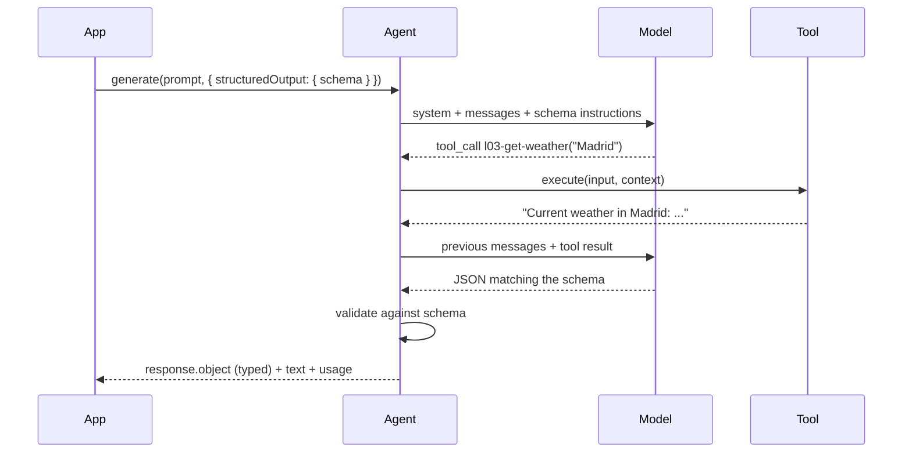

# 03 · Structured output and generation options

**Subject:** getting objects instead of prose, and controlling how the loop terminates.
**Prereqs:** 01–02 — you should be able to read a tool-call span and know where the loop closes.

## Why here

Lessons 01–02 produced text you read. Real applications branch on agent output, store it, and render it — they need objects, not prose. This lesson also makes the loop's termination explicit for the first time: until now it stopped when the model stopped asking for tools; `maxSteps` decides how many times it goes around, and a half-finished loop is a failure mode with its own trace signature.

## What one typed answer is made of



The parts of `structuredOutput` and who reads each one:

- `schema` — the zod shape the final message must satisfy. The `.describe()` strings are prompt material for the fields, exactly like tool input schemas in lesson 02. At the call site, `z.infer<typeof schema>` is the TypeScript type — one definition, two layers.
- `jsonPromptInjection` — how the schema reaches the model. Omitted or `false` uses the provider's native `response_format` — which the NaN gateway *rejects* on `deepseek-v4-flash` for any request that has tools (it serves `json_schema` only on tool-less, non-streamed calls). `'auto'` consults Mastra's capability data, which marks the model as structured-output-capable — so `'auto'` resolved to native and got the 400. `'system'` (the starting demo) and `'inline'` inject the schema as text into the system message or the latest user message instead: no `response_format` is sent, tools keep working, and the result is validated against the schema either way. On a custom gateway, pin the mode you have verified — capability data and gateway serving policy are different things.
- `response.object` — the validated, typed result. `response.text` still exists; under prompt injection it is the raw model output — a prose preamble glued to the JSON (`I'll fetch the current weather…{…}`). Never parse `text` yourself; `object` is the contract.
- `errorStrategy` — `'strict'` (default) throws when the model's output fails the schema. `{ errorStrategy: 'fallback', fallbackValue }` substitutes the fallback and sets `response.usedFallbackValue: true`, so you can tell a substituted object from a real answer.

Two things worth noticing before you run anything:

1. **This is the second schema contract.** Lesson 02 validated what goes *into* the loop (tool input and output). This one validates what comes *out* of it. Same mechanisms — zod, validation before you see the value — opposite edge of the loop.
2. **A schema cannot tell you the loop was cut.** If `maxSteps` stops the run before the tool result reached the model, the model may still produce schema-shaped JSON — invented values that validate cleanly. Termination and validation are separate checks; you will see this in the exercise below.

## The code

Read top to bottom:

- `../../src/mastra/lessons/03-structured-output/weather-tool.ts` — the same weather tool as lessons 01–02 (lessons cannot import each other), namespaced `l03-`. Its return string is *everything* the report can be built from — remember that when the exercise asks for more.
- `../../src/mastra/lessons/03-structured-output/report-schema.ts` — the starting schema: three fields, all satisfiable from the tool. `WeatherReport` is its inferred type.
- `../../src/mastra/lessons/03-structured-output/report-agent.ts` — `L03 · Report Agent`; instructions say to fill requested shapes with fetched values.
- `../../src/mastra/lessons/03-structured-output/index.ts` — the demo passes `structuredOutput` at call level.

## Walkthrough A — headless

```bash
pnpm lesson 03
```

Same loop as lesson 02, but the printed answer is `response.object` — a validated object. Three checks before moving on: the object has exactly the three schema fields; at the call site `response.object` is *typed* — hover it in `index.ts` and confirm TypeScript knows the shape without a cast; and `response.text` looks messy — a prose preamble glued to the JSON. That mess is the raw output under prompt injection, and it is exactly why `object`, not `text`, is what your application consumes.

## Walkthrough B — the trace

`pnpm dev`, then **Agents → L03 · Report Agent**, chat: *What's the weather in Madrid? Reply as a structured report.* Open the run in **Observability**.

- Same span shape as lesson 02: LLM call → tool call → LLM call. Structured output adds no spans; it rides in the model calls.
- With `jsonPromptInjection: 'system'`, find the injected schema instructions in the LLM calls' system message — the schema reached the model as text, with no `response_format` in the request. Then flip `'system'` to `'auto'` and re-run: the gateway rejects the run with a 400 whose message spells out its serving policy (`json_schema` only on tool-less, non-streamed requests for this model). Read it — that error is the gateway telling you its constraints. Set `'system'` back.
- The final LLM span's output ends in the schema's JSON, not plain prose. That is the visible difference from lesson 02's trace.

## Exercise — confidence, defaults, and a cutoff

One schema field at a time, each with a purpose.

**1. Add a judgment field.** In `report-schema.ts`, add:

```ts
confidence: z
  .enum(['low', 'medium', 'high'])
  .describe('How confident you are in the values: high if the tool returned clean data for the exact city asked, low if anything was missing or approximated'),
```

Re-run `pnpm lesson 03`. The model fills it. Predict when it says `low` (a failed fetch? a fuzzy location?) and then ask about `Nowhereville` to check. The `.describe()` string is doing the work — shorten it to just `'confidence'` and watch the values get less meaningful.

**2. Force a mismatch.** Add a required field the tool cannot provide:

```ts
pressureMbar: z.number().describe('Current atmospheric pressure in millibars'),
```

The tool's return string has no pressure. Ask for Madrid and watch one of two things happen, both instructive: the model omits it and validation fails (`errorStrategy: 'strict'` throws — read the error), or it invents a plausible 1013 and validation *passes*. The second is the worse failure: silent wrong data. Now handle it deliberately:

```ts
structuredOutput: {
  schema: reportSchema,
  jsonPromptInjection: 'system',
  errorStrategy: 'fallback',
  fallbackValue: {
    location: 'unknown',
    temperatureC: 0,
    conditions: 'unavailable',
    pressureMbar: -1,
  },
},
```

Re-run and check `response.usedFallbackValue` — it is `true`, which is how your application distinguishes a substituted object from a real answer. Remove `pressureMbar` and the fallback when done.

**3. Set defaults once.** Move the whole schema into the agent:

```ts
// report-agent.ts
defaultOptions: {
  structuredOutput: {
    schema: reportSchema,
    jsonPromptInjection: 'system',
  },
},
```

(Add the `reportSchema` import.) Then delete the call-level `structuredOutput` from `index.ts` and re-run `pnpm lesson 03` — still typed, still validated. `defaultOptions` are the agent-level defaults for every `generate()`/`stream()` call; call options still win per-field, so a one-off call can pass a different schema. Note what you did *not* write: no parsing, no `JSON.parse`, no try/catch around it.

**4. Cut the loop.** Add to the same `defaultOptions`:

```ts
maxSteps: 1,
```

Re-run the demo. One LLM step: the model emits the tool call, the tool runs, and the loop ends before the model ever sees the result. Note exactly what your user gets — an empty answer, a throw, or worse, schema-shaped JSON with invented values. Then check the trace: which spans exist, and which do not. Set `maxSteps` back to `5` (the documented default — make it explicit once, then rely on it).

**5. Stream the same object.** In `index.ts`, replace the `generate` call with:

```ts
const stream = await agent.stream(
  "What's the weather in Madrid? Reply as a structured report.",
  {
    memory: { resource: 'l03-demo', thread: 'l03-demo' },
  },
);

for await (const chunk of stream.fullStream) {
  if (chunk.type === 'object-result') {
    console.log('--- object-result chunk ---');
    console.log(JSON.stringify(chunk, null, 2));
  }
}
console.log('--- final object ---');
console.log(JSON.stringify(await stream.object, null, 2));
```

No `structuredOutput` needed in the call — exercise 3's default applies to `stream()` too. Compare with walkthrough A: same object, different arrival order. Text chunks still stream; the object lands at the end. Swap the code back to `generate` when done.

**Going further — the structuring-model workaround.** The gateway's constraint has a documented escape hatch: pass `model` to `structuredOutput`, and Mastra runs a second, separate structuring pass — the main loop keeps its tools and prose, then a tool-less call (where the gateway *does* allow `json_schema`) converts the answer:

```ts
structuredOutput: {
  schema: reportSchema,
  model: models.default, // import { models } from '../../shared/models'
},
```

Predict the trace first: the lesson-02 loop unchanged, plus one extra LLM call doing the structuring. Then check. If the gateway still refuses — it only serves `json_schema` on non-streamed requests, and you cannot control how Mastra streams that internal call — you have found the edge of its serving policy; note it and stay on prompt injection. The gateway error also suggests `qwen3.6` or `gemma4`, which accept schema-constrained output in more request shapes, but `shared/models.ts` warns that qwen/gemma chat models use XML-style tool calling — read that file before switching this lesson to them.

## Checkpoint

Run these yourself; nobody can verify a trace for you.

- [ ] `pnpm lesson 03` prints a validated object and a usage block.
- [ ] `response.object` is typed at the call site without a cast.
- [ ] You saw a validation failure handled two ways: strict throw, and fallback with `usedFallbackValue: true`.
- [ ] The schema lives in `defaultOptions` and both `generate()` and `stream()` return typed data without per-call config.
- [ ] You cut the loop with `maxSteps: 1` and can describe what the user sees.
- [ ] You can point at where the schema reached the model in the trace, and you know which requests the gateway refuses to serve natively.

## Notes

_Write what you learned here — three to five lines, in your own words._

- What the schema prompted that the instructions didn't:
- Which error strategy I would ship, and why:
- Still unclear:

## Docs

- Structured output — https://mastra.ai/docs/agents/structured-output
- `generate()` — https://mastra.ai/reference/agents/generate
- `stream()` — https://mastra.ai/reference/streaming/agents/stream
