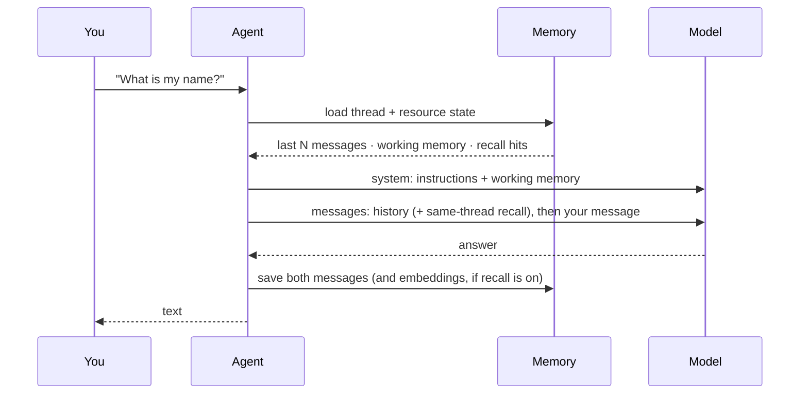

# 04 · Memory

**Subject:** what the model remembers, where it is stored, and exactly how it re-enters the context.
**Prereqs:** 01–03 — you should be able to read an LLM call span and know what a schema contract is for.

## Why here

Every lesson so far has been using memory without naming it: `new Memory({ options: { lastMessages: 20 } })` has been on the weather agent since lesson 01, and lesson 01's "run it twice" trick was message history loading from storage. This lesson names the layers and shows where each one lands in the context. Everything after this assumes you can tell "the agent forgot" apart from "the agent never received it".

## What one turn remembers



Four layers, each adding something different to that context:

- **Message history** — the last N stored messages of this thread, chronological. On by default (`lastMessages: 10` if you set nothing; this lesson uses 20). It is a *window*, not the store: trimmed messages stay in storage, they just stop being sent.
- **Working memory** — a small profile (Markdown template or zod schema) that persists per **resource**, injected as a **system message**. It is the agent's always-on scratchpad: name, units, preferences. Enabled explicitly.
- **Semantic recall** — RAG over past messages. It embeds new messages, and on each turn searches for messages similar in meaning to yours. Same-thread hits slot in as messages by timestamp; other-thread hits are formatted into a system message. Enabled explicitly, and it needs a vector store plus an embedder.
- **Observational memory** — background agents (an Observer and a Reflector) compress old history into an observation log that *replaces* raw messages. The point is a small, stable prompt prefix on long threads.

Two identifiers decide what a run can see:

- **`thread`** — one conversation. Message history and (by default) observational memory are thread-scoped.
- **`resource`** — the user or entity that owns threads. Working memory and semantic recall default to `scope: 'resource'`, so they follow the user *across* threads.

A thread's owner is fixed at creation — never reuse a thread id for a different resource.

## The code

Read top to bottom:

- `../../src/mastra/lessons/04-memory/memory-agent.ts` — `L04 · Memory Agent`, baseline: `lastMessages: 20` and nothing else. The exercise adds the other three layers here.
- `../../src/mastra/lessons/04-memory/weather-tool.ts` — the `l04-` weather tool, present so the loop has a real tool. Tool calls and results are messages too: they count against `lastMessages` and get saved like anything else.
- `../../src/mastra/lessons/04-memory/index.ts` — the demo below.
- `../../src/mastra/shared/storage.ts` and `shared/vector.ts` — storage and vector store, wired once on the Mastra instance. Agents never construct their own; that is why `Memory` here has no `storage` argument.

## Walkthrough A — headless

```bash
pnpm lesson 04
```

Three calls, one resource, two threads:

1. *"My name is Abraham and I only want Celsius"* on thread A.
2. *"What is my name, and which unit?"* on thread A — it knows.
3. The same question on thread B, same resource — it does not.

That third answer is the lesson's baseline: **history is thread-scoped even when the user is the same**. The demo generates fresh thread ids per run so you see the same three answers every time; with fixed ids you would be replaying history instead of demonstrating it.

## Walkthrough B — the trace and the memory panel

`pnpm dev`, **Agents → L04 · Memory Agent**, chat in a thread. Then:

- Open the run in **Observability** and look at the first LLM call span: its messages begin with the stored history, then your new message. That is memory loading, before the model runs.
- In the right sidebar, the memory panel shows the thread's stored messages. This is the store, not the window — compare it with what the span sent.
- Send five or six messages, then look at the span again: the context grew by whole message pairs each turn. Now you can see why long conversations need more than `lastMessages`.

## Exercise — turn the layers on, one at a time

Change one thing, then ask the same question again. Keep thread A, and use a **new thread C** on the same resource for steps 2 and 3.

**1. Shrink the window.** In `memory-agent.ts`, set `lastMessages: 2`. Re-run `pnpm lesson 04`: thread A's second turn no longer knows the name, because the answer was two turns back and the window is two messages. Nothing was deleted — the panel still shows everything. This is the difference between *forgetting* and *not receiving*.

**2. Add working memory.** Back to `lastMessages: 20`, and add to `new Memory({ ... })`:

```ts
options: {
  lastMessages: 20,
  workingMemory: {
    enabled: true,
    scope: 'resource', // default; follows the user across threads
    template: `# User Profile
- Name:
- Temperature Unit:
`,
  },
},
```

Tell it your name and unit in thread A, then ask the same question in **thread C**. Now it knows — working memory is resource-scoped, so it crossed threads. In the trace, the profile arrives as a **system message**, not a conversation message. Then say *"actually, use Fahrenheit"* — the template updates in place, and later turns see the new version.

**3. Add semantic recall.** This needs the shared vector store and an embedder that runs locally:

```ts
import { vector } from '../../shared/vector';
import { fastembed } from '@mastra/fastembed';

// in new Memory({ ... })
vector,
embedder: fastembed,
options: {
  lastMessages: 2, // deliberately too small, so old facts scroll out
  semanticRecall: {
    topK: 3,
    messageRange: 1,
    scope: 'resource',
  },
},
```

Note what is *not* here: no index creation, no dimension. `Memory` creates the index on first use (it probes the embedder's dimension once). `fastembed` downloads ~30 MB the first time; `models.embedding` from `shared/models.ts` also typechecks if you would rather use NaN's embedding API.

Now build a thread where the fact you need early is *outside* the two-message window: introduce your unit, talk about Madrid's weather, then ask *"which unit did I ask for?"*. Without recall, step 1 proved it fails. With recall, the early message comes back by meaning, even though it is not in the window — and because `scope` is `resource`, it can also come from *another* thread. Open the trace: recall hits appear as messages before your new one.

**4. Add observational memory.** Replace the `Memory` options with:

```ts
options: {
  observationalMemory: true,
},
```

Re-run a longer thread (six or eight varied messages). Observations replace the raw older messages: the trace shows a compact observation block plus only the messages not yet observed. Compare input tokens against the same conversation with plain history. Your one-sentence trade-off: raw history is exact but grows without bound; observational memory stays small and stable but is a lossy summary written by another model — and it costs background LLM calls.

**5. Inspect memory from code.** `Memory` is queryable. From a scratch script or the demo:

```ts
const memory = await agent.getMemory();
const { messages } = await memory!.recall({
  threadId: threadA,
  perPage: 50,
});
console.log(messages.length);
```

`recall()` is also how you would render a thread list in your own UI. Add `vectorSearchString` plus `threadConfig: { semanticRecall: true }` to search by meaning instead of recency.

Revert to the baseline `Memory` when done — lesson 05 mounts on top of this agent shape.

## Checkpoint

Run these yourself; nobody can verify a trace for you.

- [ ] Same thread remembers; a new thread with the same resource did not, before you added working memory.
- [ ] You shrank `lastMessages` and watched the agent lose a fact that was still stored.
- [ ] Working memory arrived as a system message and followed you into a new thread.
- [ ] Semantic recall retrieved a message that was outside the history window.
- [ ] You can state the observational-memory trade-off in one sentence.
- [ ] You can point at the memory panel and say what it shows that the span does not.

## Notes

_Write what you learned here — three to five lines, in your own words._

- Which layer my project actually needs:
- What surprised me about where memory appears in the context:
- Still unclear:

## Docs

- Memory overview — https://mastra.ai/docs/memory/overview
- Message history — https://mastra.ai/docs/memory/message-history
- Working memory — https://mastra.ai/docs/memory/working-memory
- Semantic recall — https://mastra.ai/docs/memory/semantic-recall
- Observational memory — https://mastra.ai/docs/memory/observational-memory
