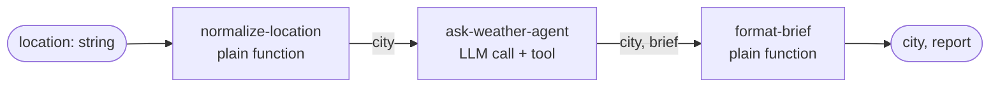

## Lab setup

**Objective:** Choose deterministic orchestration and safe resumable actions. **Time and cost:** 45–60 minutes for baseline, branch and approval; state, parallelism, foreach and time travel are optional labs. The agent step uses quota.

Start from this lesson's committed/reference baseline. Save a local copy before editing exercise variants; later lessons are isolated and do not inherit these edits. Stop Studio before `pnpm lesson 06` because both use the same writable DuckDB file, then restart it to inspect persisted traces. Use fictional data.


# 06 · Workflows

**Subject:** deterministic multi-step control flow — the steps are yours, the order is yours, and every hand-off is a schema.
**Prereqs:** 01, 02 — you should be able to read an LLM call span, and you know that a tool call makes a second model step.

## Why here

Every lesson so far has been one call: the model decides what to do inside a loop, and your code watches. That is the right tool for an open-ended request and the wrong tool for a process you already know. A release checklist, an invoice approval, a "fetch the weather, format it, post it" — you know the steps. Handing that decision to a model means relearning it every run, and getting a different answer each time.

A workflow is that decision written down. You name the steps, you choose the order, and you declare what each step accepts and returns. The model can still appear — as one step, doing one job — but it no longer decides whether the next step happens.

There is a second payoff, and it is the one lesson 01 promised. A run leaves a `steps` map: every step with its status, the payload it received, and the output it produced. That is the trace Studio draws, and it is what makes the last third of this lesson possible — stopping a run for a human, and replaying one step of a finished run.

## The chain



Three rules hold the chain together. TypeScript checks compatibility when you write the workflow. At runtime, subsequent step inputs validate handoffs; the installed engine does not automatically validate terminal output. The demo explicitly parses that output. Design schemas so:

1. The first step's `inputSchema` must accept the workflow's `inputSchema`.
2. Each step's `outputSchema` must satisfy the next step's `inputSchema`.
3. The last step's `outputSchema` must match the workflow's `outputSchema`.

That second rule is the one that shapes your code. `ask-weather-agent` returns `city` *and* `brief`, not just `brief`, because the last step needs both. A step hands forward everything the next step needs — there is no implicit access to earlier steps' outputs.

```ts
export const weatherBriefWorkflow = createWorkflow({
  id: 'l06-weather-brief',
  description: 'Normalize a location, ask the weather agent, format the answer.',
  inputSchema: z.object({ location: z.string().trim().min(1) }),
  outputSchema: z.object({ city: z.string().min(1), report: z.string() }),
})
  .then(normalizeLocation)
  .then(askWeatherAgent)
  .then(formatBrief)
  .commit();
```

`.commit()` is not decoration. Before it, you have a builder; after it, you have a runnable graph. A workflow without `commit()` will not run and will not appear in Studio.

## The other shapes

`.then()` is a line. Four more methods bend it, and each one changes the *shape* of what the next step receives:

- `.then(step)` — one step after another. The next step gets that step's output.
- `.parallel([a, b])` — two different jobs on the same input. The next step gets `{ a: …, b: … }`, keyed by step id.
- `.branch([…])` — the path depends on a value. The next step gets the outputs of the branches that ran, also keyed by step id.
- `.foreach(step)` — the same job for every item of an array. The next step gets an array, same order as the input.
- `.map(fn)` — the shapes don't line up. Whatever you return.

`.parallel` and `.foreach` are not in the lesson file — the exercise bends the line with `.branch` instead — so here is what they look like. Two jobs off one input, then a combiner that reads both by step id:

```ts
export const parallelWorkflow = createWorkflow({
  id: 'l06-weather-brief-parallel',
  inputSchema: z.object({ location: z.string().trim().min(1) }),
  outputSchema: z.object({ city: z.string(), report: z.string() }),
})
  .then(normalizeLocation)
  .parallel([askWeatherAgent, checkAirQuality])
  .then(combineSections) // inputSchema: { 'ask-weather-agent': …, 'check-air-quality': … }
  .commit();
```

`.foreach` takes an array in and gives an array out, one iteration per item:

```ts
export const foreachWorkflow = createWorkflow({
  id: 'l06-shout-cities',
  inputSchema: z.array(z.string()),
  outputSchema: z.array(z.string()),
})
  .foreach(shoutCity) // inputSchema: z.string(), outputSchema: z.string()
  .commit();
```

Both are synchronization points: the following step waits for *all* parallel branches or *all* iterations. `.foreach` also takes `{ concurrency: n }` — the default is 1, which is sequential.

## State, and when to use it

Input and output flow forward, one step at a time. State is a second channel: a shared object every step can read and update, which survives the whole run — including a suspend and resume.

- **Pass it through schemas** when the next step needs it. It is explicit, and the types check it.
- **Put it in state** when *many* steps need it, or when it is bookkeeping (progress, counters, ids for an audit log) that would otherwise be threaded through every schema.

Step 3 of the exercise does the move, and the difference is visible in the types: with state, the middle steps stop taking `city` as input at all.

## The code

Read top to bottom:

- [workflow.ts](../../../src/mastra/lessons/06-workflows/workflow.ts) — the three steps and the workflow. Steps 1 and 3 are plain functions; only step 2 calls a model.
- [weather-agent.ts](../../../src/mastra/lessons/06-workflows/weather-agent.ts) — `L06 · Weather Agent`. Note what is missing: no memory, and no instruction to ask a follow-up question. A step gets an input and returns an output; the workflow decides what happens when the input is unusable.
- [weather-tool.ts](../../../src/mastra/lessons/06-workflows/weather-tool.ts) — the `l06-` weather tool. The middle step is one agent invocation (which may make multiple model calls) with a tool call inside it, which is exactly the kind of work a step isolates.
- [index.ts](../../../src/mastra/lessons/06-workflows/index.ts) — the registry fragment and the demo: one run, printed as a trace.

The agent is looked up inside the step with `mastra.getAgentById('l06-weather-agent')` rather than imported. Every step receives `mastra`, so a step stays a function of (input, services) and the agent stays replaceable — from Studio's editor, or by a test double.

## Walkthrough A — headless

```bash
pnpm lesson 06
```

One run, input `"  madrid  "`. What you get back:

```
workflow l06-weather-brief (registered as "weatherBriefWorkflow")
run      8bc4edd4-…

--- status: success ---

--- steps ---
- normalize-location: success -> {"city":"Madrid"}
- ask-weather-agent: success -> {"city":"Madrid","brief":"…"}
- format-brief: success -> {"city":"Madrid","report":"Madrid — …"}

--- result ---
Madrid — …
```

Four things to take from this, in the order they will matter later:

- **`status` is a discriminated union**, not a boolean: `success`, `failed`, `suspended`, `tripwire`, `paused`. `result`, `error`, `suspendPayload`, and `tripwire` each exist on exactly one of those, so check `status` before reaching for them.
- **`steps` is the trace**, before Studio renders it: one entry per step, with `status`, `payload` and `output`. (The map also carries the run's own input under an `input` key; that one is not a step.)
- **`stepExecutionPath` is the order that actually ran.** On a straight line it looks redundant. On a branch it answers "which way did it go?".
- **The run has an id before it has a result.** `createRun()` hands you a `runId`, and every resumable or replayable thing in this lesson is a lookup by that id.

The middle step is the only one that costs tokens. The other two are functions — same output every run, nothing to debug.

## Walkthrough B — the graph and the trace

`pnpm dev`, then **Workflows → L06 · Weather Brief**:

- The **graph** is `workflow.ts`. Three boxes in a line. Add the branch from the exercise and the graph grows a fork before you run anything — the definition is the picture.
- The **input form** is generated from the workflow's `inputSchema`. Send `location: "   "` here and watch what happens: the run is rejected before step 1, with the schema's own message. (Headless, that is a thrown error, not a `failed` result — see *Notes*.)
- **Live status** per step while it runs, with input, output, state, and logs in the sidebar. Open the run afterwards and compare the sidebar with the `steps` map from Walkthrough A: same data, two presentations.
- **Observability** holds the same run as a trace: a workflow span, a child span per step, and inside `ask-weather-agent` the agent's LLM and tool spans. That is the link back to lesson 01 — a workflow does not replace the trace, it labels it.

## Exercise — bend the line

Work in `workflow.ts` and re-run `pnpm lesson 06` (or the Studio graph) after each step. One change at a time.

First, pull the casing into a helper — the snippets below use it, and it keeps the steps readable:

```ts
const normalizeCity = (value: string) => value.trim().replace(/\s+/g, ' ');
// Preserve accents and proper-name spelling; this is not a geocoder.
```

**1. Make the first step able to refuse.** Today `normalize-location` always succeeds and the agent is always asked. Add a flag:

```ts
export const normalizeLocation = createStep({
  id: 'normalize-location',
  inputSchema: z.object({ location: z.string().trim().min(1) }),
  outputSchema: z.object({ city: z.string(), resolved: z.boolean() }),
  execute: async ({ inputData }) => {
    const city = inputData.location.trim();
    return { city, resolved: /[a-z]/i.test(city) };
  },
});
```

Send `location: "???"` from Studio: step 1 succeeds, `resolved: false`, and the workflow still asks the weather agent. A flag nobody reads is just a field.

**2. Branch on it, then put the pieces back together.** Both branch steps need the *same* input and output schemas — the branch hands each one the same input, and the next step has to cope with either output:

```ts
const askWeatherAgent = createStep({
  id: 'ask-weather-agent',
  inputSchema: z.object({ city: z.string(), resolved: z.boolean() }),
  outputSchema: z.object({ city: z.string(), brief: z.string() }),
  execute: async ({ inputData, mastra }) => {
    const agent = mastra.getAgentById('l06-weather-agent');
    const response = await agent.generate(
      `Write a one-sentence weather brief for ${inputData.city}.`,
    );
    return { city: inputData.city, brief: response.text.trim() };
  },
});

const askForClarification = createStep({
  id: 'ask-for-clarification',
  inputSchema: z.object({ city: z.string(), resolved: z.boolean() }),
  outputSchema: z.object({ city: z.string(), brief: z.string() }),
  execute: async ({ inputData }) => ({
    city: inputData.city,
    brief: `I could not match "${inputData.city}" to a city. Which one did you mean?`,
  }),
});

export const weatherBriefWorkflow = createWorkflow({
  id: 'l06-weather-brief',
  inputSchema: z.object({ location: z.string().trim().min(1) }),
  outputSchema: z.object({ city: z.string(), report: z.string() }),
})
  .then(normalizeLocation)
  .branch([
    [async ({ inputData }) => inputData.resolved, askWeatherAgent],
    [async ({ inputData }) => !inputData.resolved, askForClarification],
  ])
  .map(async ({ inputData }) => inputData['ask-weather-agent'] ?? inputData['ask-for-clarification'])
  .then(formatBrief)
  .commit();
```

The `.map()` is doing real work: after a branch the next step receives an object **keyed by the branch step ids** — `{ 'ask-weather-agent': … }` or `{ 'ask-for-clarification': … }` — and `format-brief` wants `{ city, brief }`. The map flattens it.

Run it twice, `"new york"` and `"???"`, and compare `stepExecutionPath` in the demo output: `normalize-location → ask-weather-agent → …` in one, `normalize-location → ask-for-clarification → …` in the other. The map gets its own entry in the trace too, named `mapping_<workflowId>_0`.

Two rules that bite here. Every condition that evaluates `true` runs its step, so write conditions that cannot both be true. And the branch output is an object of *optional* keys — the types now force you to handle "neither branch ran", which is why the map ends in `??`.

**3. Move the city into workflow state.** State is declared on the workflow and on each step that touches it; a step's `stateSchema` must be a subset of the workflow's. Replace the plumbing with:

```ts
const briefState = z.object({ city: z.string() });

const normalizeLocation = createStep({
  id: 'normalize-location',
  inputSchema: z.object({ location: z.string().trim().min(1) }),
  outputSchema: z.object({}),
  stateSchema: briefState,
  execute: async ({ inputData, state, setState }) => {
    await setState({ ...state, city: inputData.location.trim() });
    return {};
  },
});

const askWeatherAgent = createStep({
  id: 'ask-weather-agent',
  inputSchema: z.object({}),
  outputSchema: z.object({ brief: z.string() }),
  stateSchema: briefState,
  execute: async ({ state, mastra }) => {
    const agent = mastra.getAgentById('l06-weather-agent');
    const response = await agent.generate(`Write a one-sentence weather brief for ${state.city}.`);
    return { brief: response.text.trim() };
  },
});

const formatBrief = createStep({
  id: 'format-brief',
  inputSchema: z.object({ brief: z.string() }),
  outputSchema: z.object({ city: z.string(), report: z.string() }),
  stateSchema: briefState,
  execute: async ({ inputData, state }) => ({
    city: state.city,
    report: `${state.city} — ${inputData.brief}`,
  }),
});

export const weatherBriefWorkflow = createWorkflow({
  id: 'l06-weather-brief',
  inputSchema: z.object({ location: z.string().trim().min(1) }),
  outputSchema: z.object({ city: z.string(), report: z.string() }),
  stateSchema: briefState,
})
  .then(normalizeLocation)
  .then(askWeatherAgent)
  .then(formatBrief)
  .commit();
```

`city` no longer appears in the intermediate step input/output schemas (the final output still includes it) — but the run still needs a starting value, so pass `initialState`:

```ts
const result = await run.start({
  inputData: { location: 'lisbon' },
  initialState: { city: '' },
});
```

And one shape detail worth measuring: `result.state` is **undefined** unless you ask for it with `outputOptions: { includeState: true }`; with the flag you get `{ city: 'lisbon' }` next to the result. State is not smuggled into the result for free.

**4. Stop before the last step and wait for a human.** Restore the baseline `workflow.ts` from the version you saved before exercise 1; this variant uses `{city, brief}` handoffs, not exercise 3's state-only variant. Keep your state experiment as notes rather than combining incompatible snippets.

 Put an approval step between the agent and the formatter. It needs three schemas, and the difference between them is the whole mechanism:

```ts
const approveReport = createStep({
  id: 'approve-report',
  inputSchema: z.object({ city: z.string(), brief: z.string() }),
  outputSchema: z.object({ city: z.string(), brief: z.string(), approved: z.boolean() }),
  suspendSchema: z.object({ city: z.string(), brief: z.string() }), // what the pause publishes
  resumeSchema: z.object({ approved: z.boolean() }),                // what you may send back
  execute: async ({ inputData, resumeData, suspend }) => {
    if (!resumeData?.approved) {
      return await suspend({ city: inputData.city, brief: inputData.brief });
    }
    return { ...inputData, approved: true };
  },
});
```

```ts
const formatApproved = createStep({
  id: 'format-brief',
  inputSchema: z.object({ city: z.string(), brief: z.string(), approved: z.boolean() }),
  outputSchema: z.object({ city: z.string(), report: z.string() }),
  execute: async ({ inputData }) => ({
    city: inputData.city,
    report: `${inputData.city} — ${inputData.brief}`,
  }),
});
```

Chain `.then(approveReport).then(formatApproved)` and run it headlessly. `run.start()` resolves — it does not hang — and the result says where it stopped:

```
status: 'suspended'
suspended: [[ 'approve-report' ]]                                    // paths to the suspended steps
suspendPayload: { 'approve-report': { city: 'Porto', brief: '…' } }  // keyed by step id
```

Resume it, from the same `run` object or from a new one built with the same `runId`:

```ts
const resumed = await run.resume({
  step: 'approve-report', // or result.suspended[0]; or omit it when only one step is suspended
  resumeData: { approved: true },
});
```

The resumed run completes the remaining steps only. Everything before `approve-report` keeps its recorded output — that is the snapshot's job: suspended, waiting for you, resumed, without re-calling the agent.

Now look at what storage kept, while the run waits:

```ts
import { createWorkflowStateReader } from '@mastra/core/workflows';

const state = await workflow.getWorkflowRunById(run.runId);
const reader = state ? createWorkflowStateReader(state) : null;

console.log(state?.status);              // 'suspended'
console.log(state?.suspendedPaths);      // { 'approve-report': [2] }, an index into the step graph
console.log(reader?.getSuspendedStep()); // { stepId, path, payload, suspendPayload, … }
```

Studio shows the same snapshot in the run's sidebar. The point is not the API — it is that a suspended run is a **row in your database**, not a process waiting in memory. You can resume it tomorrow, from a webhook, after a deploy.

**5. Time-travel one step of a finished run.** Pick a run that succeeded and re-run the last step with different input:

```ts
const replay = await run.timeTravel({
  step: formatBrief, // or its id, 'format-brief'
  inputData: { city: 'Lisbon', brief: 'Replayed by hand.' },
});

if (replay.status === 'success') console.log(replay.result.report);
// 'Lisbon — Replayed by hand.'
```

`normalize-location` and `ask-weather-agent` are **not** re-executed — one step re-ran, and the agent was not called again. Two details the output makes plain, and both are worth writing down:

- The steps map after the replay shows `ask-weather-agent`'s output as the `inputData` you supplied. The snapshot was rewritten from the point you chose: your input *is* the upstream state now.
- `stepExecutionPath` lists `format-brief` twice — the original execution and the replay. That is the honest record.

Try it on a run that *failed* and you have the recovery workflow: fix the step or its input, `timeTravel` to it, and the rest of the run carries on.

## Notes

Thrown, not returned. A schema rejection on the workflow's input — or on any step's input — **rejects** `run.start()` with an error whose `id` is `WORKFLOW_SCHEMA_VALIDATION_FAILED` and whose message starts `Invalid input data:`. A step whose `execute` throws is different: that one resolves as `status: 'failed'`, with that step marked `failed`, `result.error.message` holding your message, and `failed` persisted in the snapshot. If you branch on `result.status`, wrap the call too, or you will miss the validation case.

Branch keys, not branch values. After `.branch()` the next step's input is an object of optional keys, one per branch step id. If two conditions are true, two keys are present — non-exclusive conditions give you a run that took two paths.

`.parallel()` and `.foreach()` reshape the next step the same way. Parallel output is `{ stepId: output }`, so the next step's `inputSchema` must spell out every key; foreach output is an array, so the next step must accept an array.

The agent inside a step has no memory. No thread, no history: it is one call with one prompt. If you want conversational context, pass `memory: { resource, thread }` from inside that step's `generate()` and thread the ids through the workflow input.

There are declarative shortcuts. `.agent(agentInstance)` adds an agent as a step without `createStep`, and `.tool(tool)` does the same for a tool — both reuse the agent's or tool's own schemas, and both are what storable, dynamic workflows are built from. In this version `.agent()` requires the previous step's output to be `{ prompt: string }`, so you usually need a `.map()` in front. The explicit `createStep` version above is the one that also shows you where `mastra` comes from.

Time travel and suspend both need storage. They are snapshot operations; here [storage.ts](../../../src/mastra/shared/storage.ts) (LibSQL) is what makes Walkthrough A's claims true outside Studio.

## Checkpoint

Run these yourself; nobody can verify a graph for you.

- [ ] The Studio graph matches `workflow.ts` — three boxes in a line, then a fork once the exercise is done.
- [ ] You saw a branch take the path you predicted, both in the graph and in `stepExecutionPath`.
- [ ] You moved `city` into state and watched every input/output schema get smaller.
- [ ] A suspended run showed up as `status: 'suspended'`, survived a fresh process, and completed after `resume()`.
- [ ] You read the snapshot for that run — `suspendedPaths`, `suspendPayload`, and the reader's suspended step.
- [ ] Time travel replayed exactly one step: the agent was not called again, and the steps map showed your input.
- [ ] You can say what a step that throws returns, and what a schema rejection does instead.

## Reflection

_Write what you learned here — three to five lines, in your own words._

- Where a workflow beats an agent in my own work, and where it does not:
- State or schemas? What I would pass through and what I would share:
- The check I would want before letting a workflow resume on its own:

## Docs

- Workflows overview — https://mastra.ai/docs/workflows/overview
- Control flow — https://mastra.ai/docs/workflows/control-flow
- Workflow state — https://mastra.ai/docs/workflows/workflow-state
- Suspend and resume — https://mastra.ai/docs/workflows/suspend-and-resume
- Snapshots — https://mastra.ai/docs/workflows/snapshots
- Time travel — https://mastra.ai/docs/workflows/time-travel
- Agents and tools inside steps — https://mastra.ai/docs/workflows/agents-and-tools


## Experiment worksheet

Complete baseline and branch exercises first. Save your starting workflow locally before each optional variant. Use the baseline handoff variant for approval, or explicitly adapt both approval and formatting to workflow state.

Try approval true and false. False currently suspends again; implement a separate rejection branch if rejection should terminate. Resume after restarting the application with the same run ID; then attempt repeated resume. Before adding real side effects, use a fictional operation ID and a set of completed IDs to explain how duplicate execution is prevented. Validate terminal output explicitly and count model rounds inside the single agent invocation.

Record your evidence here; leave learner `status` unchanged until you complete the Studio checklist yourself.

| Case | Prediction | Observed tools/model rounds | Tokens/latency | Evidence or failure | Explanation |
| --- | --- | --- | --- | --- | --- |
| Baseline | | | | | |
| Changed input | | | | | |
| Failure | | | | | |

## Reset this lab

Restore the baseline chain and clear only your lab workflow runs. Preserve accented city names; formatting is not geocoding.
