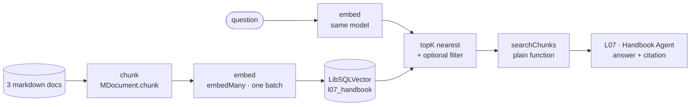

## Lab setup

**Objective:** Measure retrieval separately from answer quality. **Time and cost:** 45 minutes; `pnpm rag chunk` is API-free. Ingest embeds the corpus; query embeds a question; ask invokes an agent that can embed queries.

Start from this lesson's committed/reference baseline. Save a local copy before editing exercise variants; later lessons are isolated and do not inherit these edits. Stop Studio before `pnpm lesson 07` because both use the same writable DuckDB file, then restart it to inspect persisted traces. Use fictional data.


# 07 · RAG

**Subject:** answer from documents the model has never seen — chunk, embed, store, retrieve, then write.
**Prereqs:** 01, 02 — a tool call is a second model step with a schema, and retrieval is that same shape with a search box behind it.

## Why here

Six lessons have handed the model better instructions and better tools. Neither one puts a fact into the prompt that was never in the training data. Ask about Rill Coffee — a company that does not exist — and you get a plausible refund window, plausible prices, a plausible escalation process, in fluent prose, with nothing to mark it as invented.

That is a different kind of failure from lesson 03's. A wrong shape is visible: the parse fails, `tsc` complains, the schema rejects. A wrong *fact* looks like a good answer. So everything below is built to make the source of a claim retrievable after the fact, rather than asking the model to be honest.

Two properties separate this from every lesson before it:

- **There is an offline half.** Ingestion runs once and costs money. Queries are lookups. Lesson 06 taught you to keep expensive work out of the request path; this is the same move, applied to a corpus.
- **It fails quietly.** A missing chunk is not an error. You get a confident answer built on the second-best paragraph.

Rill Coffee is fictional on purpose. Nothing in this lesson can be answered from memory, so anything the agent gets right, it got from the index.

## The pipeline



Ingestion — four calls, in this order:

```ts
const chunks = await chunkHandbook();
const { embeddings } = await embedMany({
  model: models.embedding,
  values: chunks.map((chunk) => chunk.text),
});
await vector.createIndex({ indexName: HANDBOOK_INDEX, dimension: embeddings[0]!.length });
await vector.upsert({ indexName: HANDBOOK_INDEX, vectors: embeddings, metadata: chunks });
```

and then, per question:

```ts
const { embedding } = await embed({ model: models.embedding, value: question });
const results = await vector.query({
  indexName: HANDBOOK_INDEX,
  queryVector: embedding,
  topK: 3,
});
```

Two invariants hold the whole thing together, and both fail in interesting ways.

**The corpus and the query must be embedded by the same model.** Different models place their vectors in different spaces, and a nearest-neighbour search across two spaces returns the wrong neighbours without complaining. If the two models happen to share a dimension there is no error at all — just quietly bad rankings.

**The dimension is fixed when the index is created.** `createIndex` takes the length once, and every vector written or queried afterwards has to match. A vector of another length is rejected by the store:

```
SQLITE_ERROR: vector_distance: vectors must have the same length: 32 != 8
```

The message names both lengths, and it is why the embedding model is an *ingestion* decision: changing it later means re-embedding the corpus, not just the queries.

## Chunking decisions

The split is the one stage you control completely, and it sets both the ceiling and the floor on answer quality. It is also free — chunking is deterministic and model-free, so you can change the numbers and count chunks all day without spending a token.

```ts
const parsed = MDocument.fromText(document.text, {
  source: document.source,
  topic: document.topic,
});

const pieces = await parsed.chunk({
  strategy: 'recursive', // paragraphs, then lines, then characters
  maxSize: CHUNK_MAX_SIZE, // 400
  overlap: CHUNK_OVERLAP, // 60
});
```

`strategy` is a union, not a free string: `recursive`, `character`, `token`, `markdown`, `html`, `json`, `latex`, `sentence`, `semantic-markdown`. `recursive` splits on the largest boundary that fits and descends only when it has to, which is why these chunks end at paragraphs instead of mid-sentence. `markdown` and `html` are what you want when the structure carries meaning; `token` is what you want when the *prompt budget* is the constraint.

Three numbers to trade:

- **`maxSize`.** Bigger chunks carry more context per hit, but the citation stops naming a paragraph and starts naming a file, and every hit costs prompt tokens. Smaller chunks cite precisely, but the sentence that answers you can straddle a boundary and land in neither half.
- **`overlap`.** The tail of each chunk repeats at the head of the next. It buys you the boundary sentence, at the cost of index size and duplicate hits.
- **`topK`.** How many chunks the model sees. Three here. Raise it when the answer is spread across documents; lower it when the model starts answering from a distractor.

With the settings above, three documents become **10 chunks** — 3 from `billing.md`, 3 from `shipping.md`, 4 from `support.md`. That is the number to re-measure every time you touch the split.

## Metadata is the citation

A vector is not readable. By the time a chunk is in the index, the model can only cite what travelled with it.

`MDocument.fromText(text, metadata)` puts the metadata on the document, and `chunk()` copies it onto every chunk it produces — which is why `upsert({ metadata })` stores `{ text, source, topic, chunkIndex }` beside each vector. `chunkIndex` is added by hand here; the split does not number itself.

That metadata has two consumers:

- **The model**, through the tool's output schema. `source` is what makes `(billing.md)` possible; `score` is there for you, and is noise to the model.
- **You**, through `filter`, which cuts *before* ranking:

```ts
await vector.query({
  indexName: HANDBOOK_INDEX,
  queryVector: embedding,
  topK: 3,
  filter: { topic: 'billing' },
});
```

Every result now comes from `billing.md`. Note what kind of operation that is: not a boost, a hard cut. Filter first and you cannot retrieve the right chunk from the wrong topic — which is exactly what exercise step 3 makes you watch.

## Script → function → tool

`retrieval-tool.ts` is two things stacked, and the order matters.

`searchChunks(question, topK)` is a plain async function: embed the question, query the index, narrow the metadata into a typed shape. You can call it from a script, a workflow step, or a test with no model in the loop. The demo does exactly that and prints the result *before* the agent is asked anything.

`searchHandbook` is the `createTool` wrapper around it — a schema in, a schema out, plus a description. That description is the model's only evidence that this tool exists and when to use it. "Search the Rill Coffee internal handbook (billing, shipping, support)" is a signal; "query vectors" is not.

The reason to split them is the reason lesson 06 splits steps from the orchestrating model: the capability is the function, and the tool is one caller. When retrieval returns the wrong chunks, you want to debug that without a model in the loop.

## The code

Read top to bottom:

- [handbook.ts](../../../src/mastra/lessons/07-rag/handbook.ts) — the corpus. Three documents as `{ source, topic, text }`, fictional so nothing can be answered from memory.
- [ingest.ts](../../../src/mastra/lessons/07-rag/ingest.ts) — chunk → embed → store. `HANDBOOK_INDEX`, `CHUNK_MAX_SIZE`, `CHUNK_OVERLAP`, and `ingestHandbook()` returning the two numbers worth watching: chunk count and dimension.
- [retrieval-tool.ts](../../../src/mastra/lessons/07-rag/retrieval-tool.ts) — `searchChunks` and `searchHandbook`, in that order.
- [rag-agent.ts](../../../src/mastra/lessons/07-rag/rag-agent.ts) — `L07 · Handbook Agent`. Three instruction lines, each closing a different failure: search before answering, use only what came back, say so when nothing matches.
- [index.ts](../../../src/mastra/lessons/07-rag/index.ts) — the registry fragment and the demo: ingest, print the chunks, retrieve without a model, then ask the agent.

Ingestion **rebuilds** the index on every run — `deleteIndex` then `createIndex` — because this demo re-ingests the same three documents each time, and an append would leave stale chunks from an older chunk size behind. Real ingestion replaces per source instead: `upsert({ indexName, vectors, metadata, deleteFilter: { source } })`.

## Walkthrough A — headless

```bash
pnpm lesson 07
```

This spends quota on both halves — the corpus gets embedded, the agent gets called — so it is the one command here to run when you mean it. Output, in order:

```
index l07_handbook: 10 chunks, <dimension> dimensions each

--- chunks ---
- billing.md#0 [billing] Rill Coffee bills on the first of the month…
- billing.md#1 [billing] You can ask for a refund on any charge within 14 days…
…
- support.md#3 [support] We do not staff a phone line…

--- retrieval, no model ---
"How long do I have to ask for a refund on a subscription charge?"
  <score>  billing.md  You can ask for a refund on any charge within 14 days…
  <score>  billing.md  Failed payments are retried three times over six days…
  <score>  support.md  Anything that looks like a billing dispute…

--- answer ---
tool calls: l07-search-handbook
You have 14 days from the invoice date to request a refund; after that the
amount is credited to your next order instead (billing.md).
```

Best match first; the order itself is the embedding model's opinion, so read the shape of each line rather than the numbers. The dimension is printed rather than stated because it belongs to `models.embedding` — point the repo at another model and the number follows it.

Four things to take from this, in the order they will matter later:

- **The chunk list is the ceiling.** Retrieval can only return what ingestion stored. Read the ten lines and decide which chunk answers the refund question; if the answer is not on that list, no prompt will fix it.
- **Retrieval runs before the model, and without it.** Those scores come from a plain function — the half of RAG you can debug. If the top chunk is wrong, stop: instructions cannot rescue a ranking.
- **`tool calls:` is the model's decision, made visible.** One line, one call. The same information Studio draws as a span, from lesson 01.
- **The citation exists because the metadata did.** `(billing.md)` did not come from the model knowing anything about the file; it came out of the tool's output schema.

## Walkthrough B — Studio

**Ingest before you ask.** The agent is registered by `pnpm dev`, but nothing builds the index on startup. Ask first and retrieval fails, because in libSQL an index *is* a table:

```
SQLITE_ERROR: no such table: l07_handbook
```

So run `pnpm lesson 07` first (or call `ingestHandbook()`) and the index persists for every later Studio session: both entry points open the same file, `mastra-playground.db` at the repo root, by absolute path ([local-paths.ts](../../../src/mastra/shared/local-paths.ts)). That sounds too obvious to write down, and it is the first thing to check when Studio says *no such table* — a relative `file:./mastra-playground.db` would resolve against the dev server's working directory, which is `src/mastra/public`, and you would be looking at an empty database while a full index sat one directory up. Delete the file and you ingest again.

Then `pnpm dev`, **Agents → L07 · Handbook Agent**:

- **Ask the refund question.** One tool call, one answer, one citation. Open the **tool span** in the trace: it holds the exact chunks and scores the model was given. That span is the only honest way to audit a RAG answer, and it is the habit worth taking from this lesson.
- **Ask about something the corpus does not cover** — "Do you sell tea?" The instructions say to admit it, and it should. Watch the tool call anyway: the model searches first and finds nothing useful, which is the behaviour you wanted. Weak chunks are not the same as no chunks, and the model has to be told what to do with the difference.
- **Ask a two-document question** — "My bag arrived damaged; can I get the refund instead of a replacement?" The tool now has to return `shipping.md` *and* `billing.md`, and the answer has two claims to attribute. Compare what came back with what the answer asserts.
- **Compare the two presentations.** The headless print and the Studio sidebar are the same data with a different wrapper: your pipeline on one side, your pipeline labelled by the framework on the other.

## Exercise — break retrieval, then fix it

Work in `ingest.ts` and `retrieval-tool.ts`, re-running `pnpm lesson 07` after each step. One change at a time, and write the chunk count down each time — it is free to measure and it explains most of what follows.

**1. Move the chunk size.** Set `CHUNK_MAX_SIZE = 120` and `CHUNK_OVERLAP = 20`, re-ingest, and read the chunk list: the same three documents now become many more chunks, and the refund paragraph is split across two of them. Watch whether the question still retrieves a chunk containing "14 days".

Every iteration embeds the corpus again, so measure the split on its own first — `chunkHandbook()` is model-free and costs nothing:

```ts
// scratch.ts, next to package.json — delete it when you are done
import { chunkHandbook } from './src/mastra/lessons/07-rag/ingest';

async function main() {
  const chunks = await chunkHandbook();
  console.log(chunks.length, chunks.map((chunk) => chunk.text.length));
}
main().catch(console.error);
```

```bash
pnpm exec tsx scratch.ts
```

That is the loop to use for this step: change the numbers, run the chunk count, and only pay for the embed and the agent when the split looks right. Then go the other way — `1200` and `0` — and each document is one or two chunks: `(billing.md)` now cites a whole file, and `topK: 3` is most of the corpus in the prompt.

**2. Turn chunk size into a bill.** The second number that scratch script prints is per-chunk characters. With `maxSize: 1200` that is most of the corpus per chunk, and `topK: 3` is three of them — roughly the context you pay for on every question, on every turn. This is the trade the whole lesson is about, and it stays invisible until you multiply it.

**3. Filter, and watch it cut the answer.** Add an optional topic to the function and pass it through the tool:

```ts
export async function searchChunks(
  question: string,
  topK = 3,
  topic?: 'billing' | 'shipping' | 'support',
): Promise<HandbookMatch[]> {
  const { embedding } = await embed({ model: models.embedding, value: question });
  const results = await vector.query({
    indexName: HANDBOOK_INDEX,
    queryVector: embedding,
    topK,
    ...(topic ? { filter: { topic } } : {}),
  });
  // …the same narrowing as before
}
```

Ask the refund question with `topic: 'billing'` and every result is a billing chunk. Then ask a *shipping* question with the same filter: the store returns billing chunks that have nothing to do with it, the model sees weak evidence, and the honest answer becomes "the handbook does not cover it" — for a question the handbook answers perfectly. A filter is a cut, not a nudge.

**4. Rerank the shortlist.** Retrieve more than you need, then let a model order them:

```ts
import { MastraAgentRelevanceScorer, rerankWithScorer } from '@mastra/rag';

const candidates = await vector.query({
  indexName: HANDBOOK_INDEX,
  queryVector: embedding,
  topK: 10,
});

const reranked = await rerankWithScorer({
  results: candidates,
  query: question,
  scorer: new MastraAgentRelevanceScorer('l07-relevance', models.default),
  options: { weights: { semantic: 1, vector: 0, position: 0 }, topK: 3 },
});
```

Each entry comes back as `{ result, score }`: `result` is the `QueryResult` you passed in, `score` is the blended number. With `semantic: 1` and the other two weights at `0`, the order is the model's judgement alone — the vector similarity you already paid for is thrown away, on purpose. Feed the reranked `result`s to the tool, not the raw query output.

Two costs, both real: one model call per candidate, and a shortlist you had to embed anyway. Retrieve 10, rerank to 3. Never embed 200 to show the model 3.

**5. Swap the hand-written tool for the framework's.** `createVectorQueryTool` does the retrieval half of this lesson in one call:

```ts
import { createVectorQueryTool } from '@mastra/rag';

const queryTool = createVectorQueryTool({
  id: 'l07-vector-query',
  vectorStoreName: 'default', // how the store is registered in src/mastra/index.ts
  indexName: HANDBOOK_INDEX,
  model: models.embedding,
});
```

It reaches the store through `mastra`, so it needs no other wiring. Three differences from the hand-written tool, and all three will bite:

- **The result shape is not yours.** It returns `{ relevantContext, sources }`. Each `relevantContext` entry is `{ text, ...chunkMetadata }` — flattened, and with **no score**. Each `sources` entry is `{ id, metadata, vector, score, document }`. A model told to cite `source` still can, because the metadata is right there; a model told to weigh `score` cannot.
- **The filter is a string.** With `enableFilter: true`, the input schema declares `filter` as a coerced string that is then `JSON.parse`d, so you pass `filter: JSON.stringify({ topic: 'billing' })`. Pass the object and you get `Invalid filter format: "[object Object]" is not valid JSON` — exactly the kind of thing the hand-written version taught you to expect.
- **You inherit someone else's description.** The description is what the model reads. The built-in one is generic; override it, or the model is guessing what your index contains.

**6. Change the embedding model.** Re-ingesting with a different embedding model produces vectors of a different length, so `createIndex` has to run again with the new dimension — which `ingestHandbook()` already does. To see what happens when you skip that, without spending quota, query with a truncated vector:

```ts
await vector.query({
  indexName: HANDBOOK_INDEX,
  queryVector: embedding.slice(0, 8), // 8 dimensions against a wider index
  topK: 3,
});
```

```
SQLITE_ERROR: vector_distance: vectors must have the same length: 32 != 8
```

The message is the lesson: the index remembers one dimension, so a corpus re-embedded with another model is a *new* index. Same dimension with a different model is worse — no error, wrong neighbours. Either way, switching models means paying to re-embed the corpus, which is why it is the one decision to make before the first `upsert`.

## Notes

**The index name is a SQL identifier.** Letters, numbers, and underscores, starting with a letter, 63 characters at most. `l07-handbook` is rejected:

```
MASTRA_VECTOR_LIBSQL_CREATE_INDEX_FAILED: Invalid index name: l07-handbook. Must start with a letter or underscore…
```

Which is also why the missing-index error says "no such table".

**Metadata comes back as `Record<string, any>`.** The store does not know your corpus type, so narrow it at the boundary — that is what `searchChunks` does — instead of letting `as string` drift through the agent.

**Retrieval is not enforcement.** The model can call the tool, receive the right chunks, and still answer from memory. Instructions plus the citation requirement are the guardrail, and lesson 09 is where you measure whether they hold.

**Ingestion can go stale.** Nothing here notices when `handbook.ts` changes and the index does not. In a real system that is a re-ingestion trigger on the source, not a bigger `topK`.

**The vector store is shared.** [vector.ts](../../../src/mastra/shared/vector.ts) is the same database file lesson 04 uses for semantic recall; indexes are separate tables, so they do not collide. Delete `mastra-playground.db` to reset both — and re-ingest afterwards.

**No memory on this agent, on purpose.** Every question is answered from the same index. A thread would add history the corpus should be doing the work for, and lesson 04 already showed you the version with memory.

## Checkpoint

Run these yourself; nobody can verify a ranking for you.

- [ ] `pnpm lesson 07` printed the chunk list, retrieval scores with no model in the loop, and a cited answer.
- [ ] You can point at the chunk that answers the refund question in the printed list.
- [ ] You changed `maxSize` and predicted the new chunk count before re-running.
- [ ] A filter changed *what* retrieval returned, not just the order — including a case where it removed the answer.
- [ ] Rerank reordered results you had already retrieved.
- [ ] `createVectorQueryTool` returned the same chunks under a different shape, filter included.
- [ ] You triggered the dimension error, and can say why changing models means re-ingesting.
- [ ] In Studio, the tool span held exactly the chunks behind the answer, and an out-of-corpus question was refused rather than guessed.

## Reflection

_Write what you learned here — three to five lines, in your own words._

- What my chunk-size decision costs, and which side I would err on for my own documents:
- The question I can now ask about a RAG answer that I could not ask before:
- Where retrieval would have helped in something I have already built:

## Docs

- RAG overview — https://mastra.ai/reference/rag/overview
- Chunking and embedding — https://mastra.ai/reference/rag/chunking-and-embedding
- Retrieval — https://mastra.ai/reference/rag/retrieval
- Rerank — https://mastra.ai/reference/rag/rerank
- LibSQL vector store — https://mastra.ai/reference/vectors/libsql


## Experiment worksheet

Use `questions.ts` as a fixed five-question evaluation set. Record expected sources, retrieved sources/ranks, answer citations and unsupported claims. An unsupported question can still retrieve nearest neighbors; similarity is not proof of answerability.

Run `pnpm rag chunk` while changing chunk size, without paying to embed. When satisfied, run `pnpm rag ingest`, then `pnpm rag query "What is the refund window?"`. Use `pnpm rag ask` only for final answer comparisons. Repeat with different topK/filter settings and compare source recall. The corpus/model/chunk fingerprint rejects stale retrieved chunks; re-ingest after changing them.

Record your evidence here; leave learner `status` unchanged until you complete the Studio checklist yourself.

| Case | Prediction | Observed tools/model rounds | Tokens/latency | Evidence or failure | Explanation |
| --- | --- | --- | --- | --- | --- |
| Baseline | | | | | |
| Changed input | | | | | |
| Failure | | | | | |

## Reset this lab

Restore chunk constants and re-ingest once. Stop Studio before commands using the Mastra instance; never delete the shared database to reset only this lesson.
