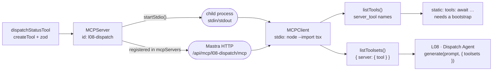

## Lab setup

**Objective:** Separate tool capability, transport and process authority. **Time and cost:** 45 minutes; direct tool/discovery calls need no model; the demo agent uses quota.

Start from this lesson's committed/reference baseline. Save a local copy before editing exercise variants; later lessons are isolated and do not inherit these edits. Stop Studio before `pnpm lesson 08` because both use the same writable DuckDB file, then restart it to inspect persisted traces. Use fictional data.


# 08 · MCP

**Subject:** one tool, two processes — exposing your tools to the world, and consuming tools you did not write.
**Prereqs:** 02 — an MCP tool is the same `createTool` contract with a schema and a description. Everything here is lesson 02 with a wire format attached.

## Why here

Seven lessons have kept one quiet assumption: the tool and the agent run in the same process. `createTool` returns an object, the agent holds a reference to it, `execute` is a function call. Nothing crosses a boundary.

MCP removes that assumption. It is, in full, a wire format for a tool call: list the tools, their JSON Schemas, and their descriptions; then call one by name with arguments and get a result back. That is it. Everything else — transports, namespacing, approvals — is bookkeeping around those two operations.

Why bother, given a function call is faster? Because the *owner* can change. A dispatch board can live in another repo, another language, or a vendor's cloud, and the agent does not have to know. The claim this lesson has to prove is narrower than it sounds: **a tool does not change when it crosses the boundary.** So the tool returns the pid of the process that ran it — `servedBy`. Two identical answers with different `servedBy` values are the whole argument, and they are checkable.

Two directions, and confusing them is the main source of difficulty:

- **Expose** — `MCPServer` wraps tools you already have and serves them.
- **Consume** — `MCPClient` connects to a server (yours or someone else's) and returns tools an agent can use.

The cost is real and worth naming up front: a second process to start and stop, a lifecycle that can leak, and a tool description you may not have written and cannot fix.

## The two halves



A transport is just how the bytes move. **stdio** means the server is a child process the client spawns and talks to over standard input/output; **Streamable HTTP** means it is a URL. The same `MCPServer` instance serves both, and this lesson demonstrates each in a different direction — stdio in the demo, HTTP through Studio.

Registration is the second half of the expose story. A server in the `mcpServers` config is mounted by Mastra at `/api/mcp/<serverId>/mcp` over Streamable HTTP, listed in Studio, and reachable from the REST route `POST /api/mcp/:serverId/tools/:toolId/execute`. That route and Studio both call `executeTool` — the same method the demo uses to make its in-process call, which is why the demo's first answer is *not* a protocol round trip.

## The name is the key

A tool has two names in this lesson, and one of them wins:

```ts
new MCPServer({
  id: 'l08-dispatch',
  tools: { [dispatchStatusTool.id]: dispatchStatusTool },
});
```

The key in that map is the tool's name **on the wire**. It is not read from `tool.id`. Register the shorthand `{ dispatchStatusTool }` and the server publishes `dispatchStatusTool`, while the tool's own id stays `l08-dispatch-status` — one tool, two names, disagreeing silently. Keying it by the id keeps a single name from schema to Studio, and that is the convention here.

Then the client namespaces what it receives, using the key *you* chose for the server in `servers` (`dispatch`):

| Where | Shape |
| --- | --- |
| `server.getToolListInfo()` | `{ tools: [{ id: 'l08-dispatch-status', … }] }` |
| `client.listTools()` | `{ 'dispatch_l08-dispatch-status': tool }` |
| `client.listToolsets()` | `{ dispatch: { 'l08-dispatch-status': tool } }` |

`listTools()` is flat and `server_tool`-prefixed, for `new Agent({ tools: … })`. `listToolsets()` is grouped by server, for `agent.generate(prompt, { toolsets })`. Both exist because both call sites exist, and the difference is only the nesting.

**There is no include/exclude filter.** The `@mastra/mcp` client has no option to expose only some of a server's tools, and that is the right design: filtering is picking keys out of the object you already have.

```ts
const all = await client.listTools();
const only = Object.fromEntries(
  Object.entries(all).filter(([name]) => name === 'dispatch_l08-dispatch-status'),
);
```

Which is worth doing: every tool in an agent's map costs prompt tokens, and an external server may export forty you will never call.

## The code

Read top to bottom:

- [dispatch-tool.ts](../../../src/mastra/lessons/08-mcp/dispatch-tool.ts) — one ordinary tool over an in-memory board of three orders. `servedBy: process.pid` is the whole teaching device.
- [server.ts](../../../src/mastra/lessons/08-mcp/server.ts) — `MCPServer` exposing that tool. No logic: every call lands in the tool's `execute`.
- [stdio.ts](../../../src/mastra/lessons/08-mcp/stdio.ts) — a **program**, not a registry entry. `startStdio()` and nothing else; it is what the client spawns.
- [mcp-client.ts](../../../src/mastra/lessons/08-mcp/mcp-client.ts) — the `MCPClient`, plus helpers around `listTools()` and `listToolsets()`. Constructing it connects nothing.
- [dispatch-agent.ts](../../../src/mastra/lessons/08-mcp/dispatch-agent.ts) — `L08 · Dispatch Agent`, with the tool attached **in process**, so Studio answers without spawning anything.
- [index.ts](../../../src/mastra/lessons/08-mcp/index.ts) — the registry fragment (agents, tools, `mcpServers`) and the demo.

The registry fragment contributes `mcpServers: { [dispatchServer.id]: dispatchServer }`; `src/mastra/lessons/registry.ts` merges that key like the others, so `mcpServers` lands in the `Mastra` config in [index.ts](../../../src/mastra/index.ts) and Studio shows the server.

One deliberate omission: **nothing connects at import time.** `stdio.ts` is only started by a client, and `mcp-client.ts` only spawns on the first `listTools()`. `mastra dev` re-imports your modules on every reload; a client that connected at import would leave a child process behind per reload.

## Walkthrough A — headless

```bash
pnpm lesson 08
```

Output, in order (pids from one run):

```
server l08-dispatch — "L08 · Dispatch Server" v1.0.0
serving: l08-dispatch-status
reached at: /api/mcp/l08-dispatch/mcp (while `pnpm dev` runs)

--- client sees ---
dispatch_l08-dispatch-status
toolsets: dispatch(l08-dispatch-status)
[MCP_SERVER] Tool executed successfully { tool: 'l08-dispatch-status' }

--- the same order, twice ---
in-process : on the van, Mira, 3h, pid 49602

--- agent, tools passed per call ---
tool calls: l08-dispatch-status
KF-1042 is on the van with Mira and should arrive in about 3 hours.
over MCP   : answered by pid 49617
Different pid — this process is 49602; the tool ran in the child.

client disconnected; the child process is gone.
```

Five things to take from it:

- **The server information comes before anything is alive.** `getServerInfo()` and `getToolListInfo()` are descriptors of a configuration — no process, no port. `version_detail.release_date` is the moment this `MCPServer` was constructed, not a release.
- **The pid in `in-process` equals the pid running the demo.** `executeTool(id, args)` is the Studio REST path, invoked locally: `{ status: 'completed', output: { …, servedBy } }`. No protocol involved.
- **`[MCP_SERVER] Tool executed successfully` is Mastra's MCP server reporting a call.** Log lines are not evidence about which process did the work — `servedBy` is.
- **`tool calls: l08-dispatch-status` is the model's decision**, made visible, exactly as in lesson 07 — but this time the tool it called was running in a different process, and the agent was constructed without it.
- **The two pids differ, and the second one is not the demo's.** That is the boundary. Nothing else in the output would have told you.

Drop `disconnect()` and the process does not exit: the child and its pipes keep the event loop alive, so the script prints everything, looks finished, and hangs. Verified here — still running after fifteen seconds. `disconnect()` closes the child; a demo that forgets it is the most common MCP bug, and it fails *after* the work looks done.

## Walkthrough B — Studio

`pnpm dev`, then **MCP → `l08-dispatch`**:

- **It lists two tools.** Click it, run it with `orderId: KF-1042`. The answer's `servedBy` is the dev server's pid — a third process, neither the demo's nor the child's. Same tool, three pids, no code differences.
- **Read the instructions it advertises.** `dispatchClient.getServerInstructions()` returns them after a connection; those are the words an external client's model *could* see, and they are not your agent's instructions.
- **Agents → L08 · Dispatch Agent.** Ask where `KF-1043` is. This agent has the tool attached in-process, so nothing spawns — compare the trace with the demo: same span, one fewer process.
- **Look at the tool span.** It holds the input, the output, and the `servedBy` field. That pid is how you answer "did this really run somewhere else?" without trusting a log line.

An external MCP client supporting a subprocess `cwd` can start the lesson's server itself:

```json
{
  "mcpServers": {
    "l08-dispatch": {
      "command": "node",
      "cwd": "/absolute/path/to/mastra-playground",
      "args": ["--import", "tsx", "/absolute/path/to/mastra-playground/src/mastra/lessons/08-mcp/stdio.ts"]
    }
  }
}
```

Set the working directory to the checkout so Node resolves the local `tsx` loader. If your client has no `cwd` setting, use an absolute loader file URL in `--import` as the lesson client does; an absolute entry path alone does not resolve the loader.

## Exercise

**1. Attach MCP tools to an agent at startup.** `listTools()` is async, so a `tools` map built from it cannot be a plain module constant. Add to `mcp-client.ts`:

```ts
export async function createMcpDispatchAgent() {
  return new Agent({
    id: 'l08-mcp-agent',
    name: 'L08 · MCP Dispatch Agent',
    instructions: 'Answer from the dispatch tool only.',
    model: models.default,
    tools: await dispatchClient.listTools(),
  });
}
```

Then call it from the demo and ask the same question. The tool name the model sees is now `dispatch_l08-dispatch-status` rather than `l08-dispatch-status` — the agent's map is namespaced, and a prompt or an eval that references the bare name breaks.

The project declares `type: module`, so top-level await works in its TypeScript scripts. Keep connection work in explicit async factories so imports stay free of spawned processes.

**2. Filter the map.** Keep one tool:

```ts
const wanted = 'dispatch_l08-dispatch-status';
const { [wanted]: tool, ...rest } = await dispatchClient.listTools();
if (!tool) throw new Error(`Missing tool: ${wanted}`);
const filteredAgent = new Agent({
  id: 'l08-filtered-agent', name: 'L08 · Filtered Agent',
  model: models.default, instructions: 'Answer only from the available dispatch tool.',
  tools: { [wanted]: tool },
});
console.log(`dropping ${Object.keys(rest).length} tool(s)`);
```

Compare the agent's tool list before and after. Nothing is blocked server-side; the model simply never learns the others exist. Then try a name that does not exist and watch what a filtered-to-nothing agent does when asked an order question — record whether it abstains or fabricates. Missing tools should be rejected by application code when they are required; model behavior is not a reliable failure signal.

**3. Consume your own server over HTTP.** With `pnpm dev` running:

```ts
const httpClient = new MCPClient({
  id: 'l08-http-client',
  servers: { dispatch: { url: new URL('http://localhost:4111/api/mcp/l08-dispatch/mcp') } },
});
console.log(Object.keys(await httpClient.listTools()));
await httpClient.disconnect();
```

Same tool names, same schemas, same `servedBy` — now the pid is the dev server's, and the transport is a URL instead of a pipe. Two differences worth noticing: HTTP needs the server already running (a stdio server is started *by* the client), and a client can outlive a server it did not start. Stop `pnpm dev` mid-call and read the error.

**4. Register someone else's server in Studio.** A remote server's tools do not appear in Studio by themselves — Studio lists `mcpServers` on *your* instance. The bridge is a proxy:

```ts
const external = new MCPClient({
  id: 'l08-external',
  servers: { board: { url: new URL('https://example.com/mcp') } },
});

export const mastra = new Mastra({
  mcpServers: { ...(await external.toMCPServerProxies()) },
});
```

`toMCPServerProxies()` wraps each configured connection as an `MCPServerBase`, so an external server shows up next to your own. If top-level `await` is unavailable to you, do the same inside an async bootstrap that constructs `Mastra` after the client connects. Point it at your own `/api/mcp/l08-dispatch/mcp` first: a proxy of a server you wrote is the only version you can debug.

**5. Require approval before a call runs.** On the client side, per server:

```ts
servers: {
  dispatch: {
    command: process.execPath,
    args: ['--import', 'tsx', STDIO_ENTRY],
    requireToolApproval: ({ toolName }) => toolName === 'l08-dispatch-status',
  },
}
```

It plugs into the same human-in-the-loop approval flow as lesson 06's `suspend`, so a tool call becomes something a human confirms. The function form is the point: read-only tools pass through, writes wait. If you are tempted to let the server's `annotations.readOnlyHint` decide — don't, unless you trust the server; annotations are advisory and a malicious server can claim a delete is read-only.

**6. Survive a broken server.** Add a second server that cannot start — a bogus `command` — and use `listToolsWithErrors({ perServerTimeoutMs: 3_000 })`:

```ts
const { tools, errors, errorDetails, durations } = await dispatchClient.listToolsWithErrors({
  perServerTimeoutMs: 3_000,
});
```

The working server's tools are still there; the broken one is in `errors` with its message, and `durations` tells you which server is slow rather than dead. That is the difference between `listTools()` — successful discoveries without per-server error reporting — and the shape you actually want in production.

## Optional exercise — remember the order across turns

**Prerequisite:** lesson [04 · Memory](../04-memory/README.md). Allow another 15–20 minutes. Each comparison makes additional agent/model calls and uses gateway quota. Basic message history adds no embedding or observation-model calls.

The baseline deliberately has no `memory` option. Studio's **Memory → No memory configuration available** is expected for **L08 · Dispatch Agent**. The shared LibSQL storage exists, but each agent chooses whether to persist and reload conversation history. MCP supplies tools; it does not supply that history.

Predict what happens when a customer asks *“Where is order KF-1042?”*, then *“Who is delivering it?”* The second question contains no order ID. Can the agent identify the order from the context it actually received? A plausible answer alone is not proof of memory: Studio or another client may resend prior messages.

**1. Establish a controlled stateless baseline.** In this lesson's `index.ts`, replace the existing `const response = await agent.generate(...)` block with the following. Keep it inside the existing `try`, after discovery and the `agent` lookup, so the remote-PID assertion and `finally` disconnection remain in place:

```ts
const response = await agent.generate('Where is order KF-1042?', { toolsets });
const followUp = await agent.generate('Who is delivering it?', { toolsets });
console.log('Follow-up:', followUp.text);
```

Stop Studio, then run `pnpm lesson 08`. Both calls receive only their new question: this code does not pass earlier messages. Record whether the follow-up asks for an order ID, invents one, or answers correctly. Inspect the second model request after restarting Studio; an answer can be correct by chance.

**2. Enable message history on the agent.** Add this import to `dispatch-agent.ts`:

```ts
import { Memory } from '@mastra/memory';
```

Add this property to the existing `new Agent({ ... })` configuration:

```ts
memory: new Memory({
  options: { lastMessages: 20 },
}),
```

Reuse the shared storage configured in `src/mastra/index.ts`; do not create another store. Leave working memory, semantic recall, and observational memory disabled for this comparison.

**3. Give both calls the same conversation identity.** Replace the two-call block from step 1 with:

```ts
const memory = {
  resource: 'l08-memory-student',
  thread: `l08-memory-${crypto.randomUUID()}`,
};
const response = await agent.generate('Where is order KF-1042?', {
  toolsets,
  memory,
});
const followUp = await agent.generate('Who is delivering it?', {
  toolsets,
  memory,
});
console.log('Memory thread:', memory.thread);
console.log('Follow-up:', followUp.text);
```

Generate the thread ID **once before both calls**. A new ID for each call would isolate the conversations. Pass `toolsets` on both calls too: per-call MCP tools are not automatically retained by message history.

Stop Studio before rerunning the demo. Then restart Studio and inspect **L08 · Dispatch Agent**: its Memory configuration should show history enabled with 20 last messages. Open the printed thread and the second call's trace. Look for the earlier order ID in the loaded messages, compare the courier against the tool result, and check whether another tool call refreshed the board. Remembering an order ID is different from assuming an old delivery status is still current.

**4. Change only the thread.** Send the follow-up again with the same resource but a fresh thread ID. Inspect whether earlier order messages are absent. Message history is thread-scoped; a common resource alone does not copy it into another thread. Resource IDs also do not authenticate a customer or authorize access to an order.

Add this after the same-thread follow-up, inside the existing `try`:

```ts
const isolatedFollowUp = await agent.generate('Who is delivering it?', {
  toolsets,
  memory: {
    resource: memory.resource,
    thread: `l08-memory-${crypto.randomUUID()}`,
  },
});
console.log('New-thread follow-up:', isolatedFollowUp.text);
```

| Variant | Earlier order messages in model context? | Courier claim supported by a tool result? |
| --- | --- | --- |
| Stateless baseline, fresh question per call | Record evidence | Record evidence |
| History enabled, same resource and thread | Record evidence | Record evidence |
| History enabled, same resource and new thread | Record evidence | Record evidence |

**Reset:** restore the original single-call demo and remove the `Memory` import/property from `dispatch-agent.ts`. Leave `disconnect()` in `finally`. Removing memory configuration does not delete previously saved threads; use fresh IDs or remove only your lab threads in Studio. The stateless baseline should again show no memory configuration.

## Notes

**Working directory and loader resolution are explicit.** Installed `MCPClient` supports `cwd`. The lesson sets it to the checkout and resolves the `tsx` loader to an absolute URL. This works even when a client starts elsewhere. A bare `--import tsx` resolves from cwd, not from the absolute entry file's directory. `process.execPath` selects the current Node executable; it does not locate packages.

**Environment filtering is not sandboxing.** A curated subprocess environment limits automatic variable forwarding. A child running as your user can still read `.env` and other accessible files, use the network, and execute programs. Audit third-party executables; use separate OS/container isolation when needed. Forward required secrets explicitly through `env`; `inheritDefaultEnv: false` narrows inherited variables, not filesystem permissions.

**Errors take one of two shapes, chosen by you.** Default is `onToolError: 'throw'`: an in-band failure becomes a `MastraError` carrying the server's own message, so it reaches the model, the spans, and the scorers. Verified with an unknown order:

```
{"message":"Order KF-9999 is not on the dispatch board. Known ids: KF-1042, KF-1043, KF-1044.",…,"code":"TOOL_EXECUTION_FAILED"}
```

Set `'return'` and you get the raw `CallToolResult` (`isError`, `content`, `structuredContent`) to handle yourself. A throw is usually right: a tool that fails silently teaches the model that failing is fine.

**Server instructions are opt-in and untrusted.** `forwardInstructions: true` appends a server's own instructions to an agent's system prompt. That is remote text becoming system text — enable it for servers you trust, read it first with `getServerInstructions()`, and treat tool *output* the same way: it lands in the model's context, so a hostile server can write instructions into a result. Tool responses are not sanitized; that is what lesson 05's processors are for.

**The protocol revision is negotiated.** The client speaks MCP `2026-07-28` and probes with `server/discover` on connect, falling back to the older `initialize` handshake for servers that have not upgraded. `protocolVersion: 'legacy'` pins the old path; newer-only features (`resources.subscribe()`, `inputRequests`) fail with an error naming the revision instead of silently doing nothing.

**`executeTool` can suspend.** It is the Studio/REST entry point and it reports suspensions rather than pretending to fail: a tool that suspends returns as such, and the caller continues with `resumeData` and `suspendPayload`. That is lesson 06's human-in-the-loop, reachable over HTTP.

**A tool's identity is three strings.** The `createTool` id, the key in the `MCPServer` tools map (the wire name), and the client namespace plus server key (`dispatch_…`, or `dispatch` nested in a toolset). Only the first is yours by convention; align the server key with the tool id, then account for the derived client namespace explicitly.

**Connections are reused.** Repeated discovery reuses an existing connection and may re-list tools; it does not necessarily spawn another child. For a cold start against a slow server, `listToolDefinitions()` returns plain JSON you can store (it survives `JSON.stringify`), and `toolsFromDefinitions()` rebuilds a namespaced tool map from it with no connection until a tool is actually called.

## Checkpoint

- [ ] `pnpm lesson 08` printed the server's tool list, an in-process answer, and a second answer with a *different* pid.
- [ ] You can explain, in one sentence, which line proves the call crossed a process boundary.
- [ ] You removed `disconnect()` and watched the process keep running, then put it back.
- [ ] In Studio, the MCP page listed `l08-dispatch` and its tool answered with the dev server's pid.
- [ ] An agent used the tool with no `MCPServer` in its tool map — tools arrived per call.
- [ ] Filtering the tool map changed what the model could see, and an empty map changed the answer without an error.
- [ ] You connected over HTTP instead of stdio, and can say who starts the server in each case.
- [ ] A broken second server left the working one's tools intact.
- [ ] You can say when MCP is worth the extra hop, and when a `createTool` in the same process is simply better.
- [ ] Optional memory lab: you compared stateless, same-thread, and new-thread follow-ups using the actual model context as evidence, then restored the baseline.

## Reflection

_Write what you learned here — three to five lines, in your own words._

- The boundary I would put behind MCP first, in something I have already built:
- What the description of a tool I did not write costs me, compared with one I did:
- Where in this repo a process hop would be a mistake:

## Docs

- MCP connections — https://mastra.ai/docs/connections/mcp
- MCP server — https://mastra.ai/reference/tools/mcp-server
- MCP client — https://mastra.ai/reference/tools/mcp-client
- MCP routes (REST + `/api/mcp/:serverId/mcp`) — https://mastra.ai/reference/server/routes
- Model Context Protocol specification — https://modelcontextprotocol.io
- Message history (optional exercise) — https://mastra.ai/docs/memory/message-history


## Experiment worksheet

The server now exposes status lookup and order-listing tools. Filter to status only and inspect the actual agent tool map. Compare in-process, stdio and HTTP results, PIDs, latency and cleanup. Run HTTP only after a human starts Studio.

Configure a missing executable and inspect `listToolsetsWithErrors`; require the expected tool before making a model call. The baseline demo rejects local fallback or missing remote results. Test `requireToolApproval` using the human approval UI and decline one request. Discovery, annotations and prompt text do not authorize tool execution. A subprocess with a reduced environment still has your filesystem permissions; use OS/container isolation for stronger boundaries.

Record your evidence here; leave learner `status` unchanged until you complete the Studio checklist yourself.

| Case | Prediction | Observed tools/model rounds | Tokens/latency | Evidence or failure | Explanation |
| --- | --- | --- | --- | --- | --- |
| Baseline | | | | | |
| Changed input | | | | | |
| Failure | | | | | |

## Reset this lab

Restore the original server definitions, disconnect clients in finally, and remove proxy experiments. Never test lifecycle failures by leaving orphaned children running.
